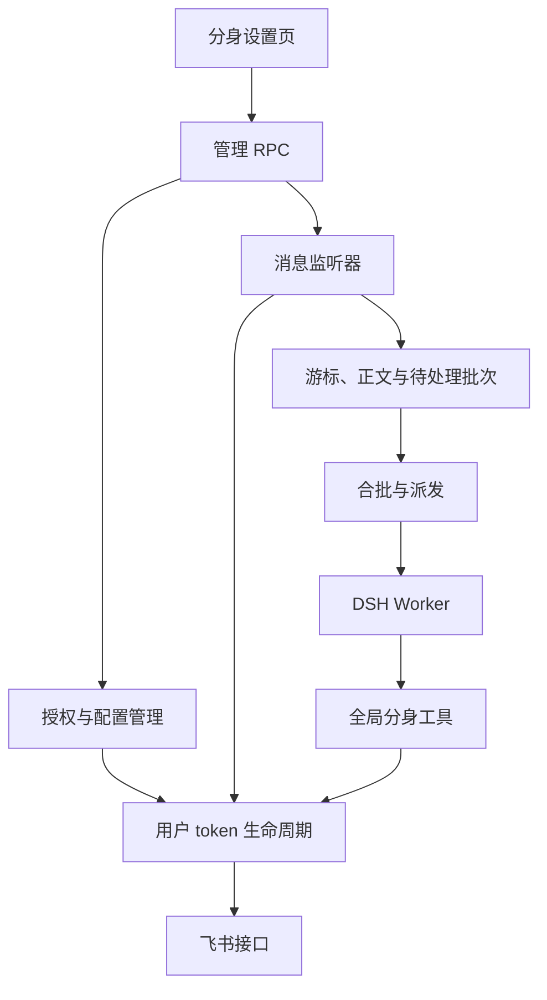

# 飞书分身：开发架构

本文描述当前源码的职责与接口。使用入口见[使用与排障](user-identity.md)，消息规则集中在[监听与派发规则](user-message-monitor-design.md)。

## 运行结构

`index.js` 在 Host 中创建一套授权服务、管理服务和监听器，注册三个全局工具与提示词贡献。插件不提供单独的分身子路径插件或预设。



普通 DSH 会话也可以直接调用全局分身工具。自动 Worker 的区别是绑定了一个飞书会话，并获得专属动态上下文；工具本身不限制只能发送到绑定目标。

## 源码职责

路径均相对于 `src/user-identity/`，除非另有说明。

| 文件 | 职责 |
|---|---|
| `app.js` | 从机器人配置及 DSH credentials 解析应用 |
| `config.js` | 用户身份配置、固定 scope 集合及版本迁移 |
| `oauth.js` | Device Flow、设备码轮询、刷新 token 的协议调用 |
| `connect.js` | 设备授权状态机、轮询定时器与取消控制 |
| `auth.js` / `token-store.js` | 凭证校验、刷新合并、用户信息及持久化 |
| `manager.js` | 设置页授权操作、二维码及后台续期 |
| `api.js` / `errors.js` | 用户身份 OpenAPI、消息解析、卡片与媒体发送、错误类型 |
| `tools.js` / `contributions.js` | 三个模型工具的契约、执行与 Host 全局注册 |
| `monitor.js` | 会话发现、游标轮询、流式卡片收尾、触发判断与背景记录 |
| `monitor-store.js` | 监听配置、消息状态归一化、队列容量与 Worker 绑定 |
| `auto-reply.js` | 合批调度、Worker 复用 / 重建、消息快照投递与清队 |
| `worker-context.js` | 默认回复模板、Worker 的两块带标签动态上下文 |
| `../policy.js` | 全局飞书工具与身份约定 |
| `../rpc.js` / `../contracts.js` | 设置页接口与前后端共用的方法名 |
| `../../client/identity.js` | 分身弹层、授权状态、监听设置与回复规则编辑 |
| `../../client/hooks.js` | 查询、串行保存、轮询及编辑草稿管理 |

## 授权生命周期

设备授权依次取得设备码、等待用户确认、换取 token、查询用户信息，再保存凭证。`manager.js` 隔离设置保存及二维码生成的旧请求；`connect.js` 用请求代次和取消信号隔离设备流程。取消或发起新连接后，旧请求不能覆盖新状态；取消信号传递到设备请求、轮询、用户信息查询和待提交的 token 保存。

`auth.js` 在使用凭证前重新读取配置与 token，核对 appId 和授权用户。access_token 剩余不足 60 秒时按需刷新；工具遇到已知 token 失效错误码时，强制刷新并重试一次。

`manager.js` 每 15 分钟检查一次凭证：access_token 剩余不超过 10 分钟，或 refresh_token 剩余不超过 2 天时尝试续期。过期时间取 OAuth 响应，不写死 token 寿命。

刷新请求在同一进程内按 token 文件路径合并。刷新返回后会重新读取凭证，避免用旧结果覆盖已经变更的授权。新设备授权只有在应用和 open_id 都相同时，才允许沿用响应中省略的旧凭证字段。

当前没有跨进程刷新锁；不要让多个 DSH 进程共用同一份 token 文件。

## 工具与提示词的范围

| 内容 | 注册入口 | 范围 |
|---|---|---|
| `feishu_avatar_me` / `messages` / `send` | `tools.register()` | Host 全局 |
| 飞书通用约定与本人身份能力 | `systemPrompt.section()` | 全局 |
| 会话信息 | `systemPrompt.context()` | 按持久化 Worker sessionId 匹配 |
| 自定义回复规则 | `systemPrompt.context()` | 同上；每次模型请求读取最新配置 |
| 本批正文、ID、时间与背景 | `session.prompt()` | 每次派发的用户消息快照 |

完整标签与规则来源见[Worker 输入](user-message-monitor-design.md#worker-输入)。无需等待 Agent 就绪后补挂工具，也没有 `reply` / `skip` 决策工具或批次令牌校验。

## 持久化与并发

默认数据目录为 `~/.dsh/integrations/im-feishu`，实际路径由 Host 初始化时确定。

| 文件 / 服务 | 保存内容 |
|---|---|
| `user-identity.json` | 机器人应用选择、scope 及 scope 版本 |
| `user-token.json` | appId、用户 token、有效期、scope、授权用户与授权时间 |
| `monitor.json` | 监听开关、会话及触发配置、Worker 工作区 / 预设、转人工关键词、回复规则 |
| `monitor-state.json` | 游标、分页进度、去重 ID、正文、待处理批次、待收尾卡片、Worker 会话绑定 |
| DSH credentials | 机器人应用 App Secret |

JSON 文件以 0600 权限写入，目录按 0700 创建。`src/json-store.js` 串行执行每个 store 的更新，并通过临时文件替换实现原子写入；写成功才发布内存状态。这不是文件加密或跨文件事务。

配置更新与单聊天状态更新在写队列内基于最新状态合并；正文、游标和新批次 ID 一起提交。派发确认只移除本次快照中的 ID，保留并发到达的新消息。Worker 绑定独立于批次保存，清队、重建 Worker 或移除监听后，已接收任务仍能读取目标会话。

设置页及管理 RPC 不返回 token 明文。停止监听和断开授权分别控制调度与凭证；两者都不撤销 Host 已接收的 Worker 任务。

## 管理 RPC

方法名以 `src/contracts.js` 为准，处理入口为 `src/rpc.js`。

| 方法 | 输入 / 用途 |
|---|---|
| `user.status` | 授权、应用、缺失 scope 与设备连接状态 |
| `user.connect.begin` | `{ botId }`，发起设备授权 |
| `user.connect.cancel` | 取消设备授权流程 |
| `user.disconnect` | 清除本地用户 token |
| `user.refresh` | 强制尝试刷新 token |
| `user.monitor.status` | 监听与待处理状态、回复规则及默认模板 |
| `user.monitor.chats` | 发现本人可见的候选会话 |
| `user.monitor.add` / `remove` | 添加会话描述 / 按 chatId 移除 |
| `user.monitor.enable` | `{ enabled }`，启停监听调度 |
| `user.monitor.chat.set` | `{ chatId, mode?, keywords?, replyToBots? }` |
| `user.monitor.worker.options` | 工作区、预设及默认工作区选项 |
| `user.monitor.worker.set` | `{ workspaceId?, workspacePath?, preset? }` |
| `user.monitor.handoff.set` | `{ keywords }`，空列表关闭转人工匹配 |
| `user.monitor.reply-rules.set` | `{ rules }`，空白恢复默认模板 |
| `user.monitor.poll` / `flush` | 立即拉取 / 尝试派发积压 |

## 验证与维护

```sh
npm test
```

该命令先构建设置页，再运行测试。`test/user-identity-*.test.mjs` 覆盖授权、工具、API、监听和上下文；`test/reliability.test.mjs` 覆盖队列、并发、分页、重启与卡片收尾；`test/client-state.test.mjs` 覆盖查询和编辑状态。

授权生命周期与取消竞争见 `test/user-identity-lifecycle.test.mjs`。这些测试使用本地模拟接口，不会向真实联系人发送消息，也不替代真实飞书环境的验证。

修改功能时同步更新对应专题文档；默认参数以 `monitor-store.js`、权限以 `config.js`、提示词以 `policy.js` 和 `worker-context.js` 为准。文档不另存测试计数、旧工作区变更清单或已经废弃的架构建议。

流程 SVG 由 `python3 scripts/build-avatar-flow.py` 生成，HTML 入口直接引用它。修改图示时调整生成脚本后重新生成，避免两份图不一致。
