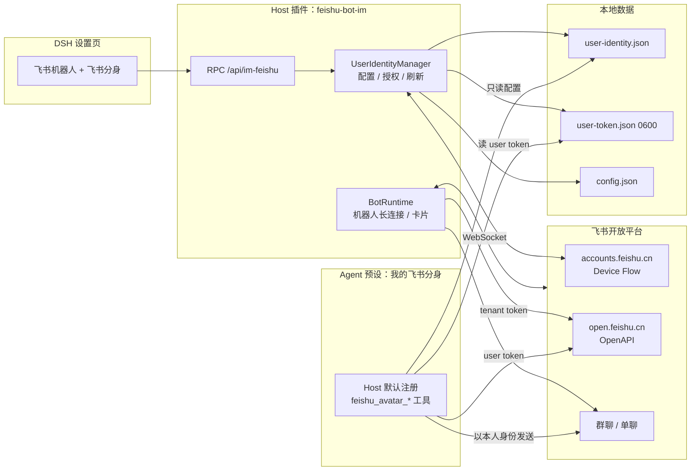
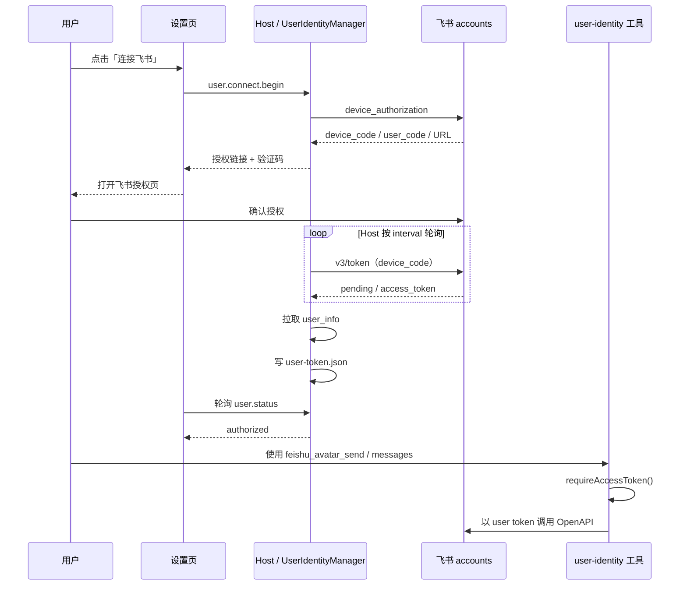

# 飞书分身：本地变更分析与集成架构

> 可视化架构图：[user-identity-architecture.html](user-identity-architecture.html)

> 历史分析快照（基线：`v0.4.1` / `dfddda4`）。当前实现已经提交；`feishu_avatar_*` 工具现由 Host 默认注册，插件不再提供预设。scope/RPC/token 策略以 [user-identity.md](user-identity.md) 和 [feishu-scopes.md](feishu-scopes.md) 为准。

## 1. 本地变更快照

已修改的跟踪文件：

```text
README.md
client.js
index.js
package.json
src/rpc.js
```

新增文件：

```text
docs/user-identity.md
src/user-identity/            15 个文件
test/user-identity-*.mjs      6 个测试
```

测试结果：

```text
user identity config   20
user identity oauth    36
user identity auth     30
user identity tools    26
user identity connect  12
user identity rpc       9
原有测试全部通过
```

结论：**功能主链路已经落地，尚未提交、未发版。**

## 2. 当前实现是什么

飞书分身已经并入 `@czwjss/feishu-bot-im`，不再拆成独立 npm 包。

它分成 Host 侧和 Preset 侧：

```text
Host 侧（全局加载）
  设置页 UI
  用户身份配置
  设备授权 / token 刷新
  RPC
  不注册 feishu_avatar_* 模型工具

Preset 侧（按需加载）
  @czwjss/feishu-bot-im/user-identity
  注册 feishu_avatar_* 工具
  读取同一个 token 文件
```

因此普通群聊 Agent 看不到用户身份工具。

## 3. 已实现能力

### OAuth

使用飞书设备授权（Device Flow）：

```text
POST accounts.feishu.cn/oauth/v1/device_authorization
  → verification_uri_complete + user_code
用户在飞书确认
POST accounts.feishu.cn/oauth/v3/token
  → user_access_token + refresh_token
```

特点：

- 不需要重定向 URL；
- 不需要本机回调端口；
- 复用机器人的 App ID / App Secret；
- 设置页显示授权二维码；
- Host 后台轮询，设置页只轮询状态。

### 设置页入口

`client.js` **不新增设置页签**，而是在每个机器人卡片的操作区加一个入口：

```text
[分身] / [分身：陈志文]
```

点开是一个小弹层：

- 显示该机器人对应的应用；
- 发起设备授权；
- 显示飞书授权二维码；扫码即可完成确认；
- 查看授权用户；
- 重新授权 / 刷新 token / 断开授权。

入口绑定到具体机器人；当前仍只保存一份用户身份授权，切换应用会覆盖旧授权。
授权 scope 固定为：

```text
offline_access im:message im:message.send_as_user im:message:readonly
```

### RPC

```text
user.status
user.connect.begin
user.connect.cancel
user.disconnect
user.refresh
```

### 工具

只在预设挂载 `./user-identity` 时出现：

| 工具 | 能力 |
|---|---|
| `feishu_avatar_me` | 授权用户身份信息 |
| `feishu_avatar_messages` | 以本人身份读群历史 |
| `feishu_avatar_send` | 以本人身份发送文本 |

## 4. 数据流



## 5. 设备授权时序



## 6. 隔离边界

```text
Host 插件
  没有 feishu_avatar_* 工具
  只做设置、OAuth、token

普通群聊 Agent
  只有 feishu_bot_* 工具

我的飞书分身
  额外挂载 ./user-identity
  只有 feishu_avatar_* 工具
```

但要注意：**预设隔离工具，不隔离会话绑定**。如果「我的飞书分身」会话被绑定到飞书群，群成员仍可能诱导工具。

## 7. 本地实现中发现的问题

### P0（本次已缓解）：Preset 侧的 token/config 过期

Host 和 Preset 各自创建了 `UserIdentityConfigStore` / `UserTokenStore`。
Preset 的 store 如果只在 Agent 创建时加载一次，用户后连接时工具会读到旧状态。

本次已在 `requireAccessToken()` 和 `refresh()` 前重新加载磁盘配置和 token，
所以“先建会话、后授权”可以工作。

仍未解决的是 Host 和 Preset 两边同时刷新 token 的竞争；见下一项。

### P0：刷新 token 的并发竞争

Host 设置页和 Preset 工具都有独立的 `UserIdentityAuth` 和 `UserTokenStore`。

飞书 refresh_token 是一次性轮换的：

```text
Host 刷新 → refresh-2
Preset 同时刷新 → 仍在用 refresh-1
→ 一边失败，甚至 refresh_token 失效
```

建议共享同一个 token 刷新服务或加文件锁/单飞锁。

### P0：当前是“复用机器人应用”，不是“独立分身应用”

代码实际行为：

```text
resolveIdentityApp()
  → 取某个 bot 的 appId / secretRef
```

文档也写明复用，不需要新建应用。

但之前确认的决策是「单独飞书分身」。这两个方向不一致，需要二选一：

1. 复用机器人应用：保持现状，改决策/文档；
2. 独立分身应用：在设置页增加 App ID/Secret，独立 credentials 和 token appId，不能再从 BotConfig 里取。

### P1：scope 变化后没有提示重新授权

现在设置页不提供 scope 编辑，默认使用固定 scope。
如果用户手动修改 `user-identity.json`，或应用后台权限变化，旧 token
仍可能缺 scope，工具报 99991679。

建议后续在状态里比较 token scope 和期望 scope，给出“重新授权”提示。

### P1：会话绑定没有 guard

工具只在预设里，但预设会话仍可能被绑定到飞书群。

建议：

- `./user-identity` 检查当前 session 是否绑定飞书 chat；
- 绑定到群时禁用用户身份工具，或只允许 Web 会话。

### P1：当前只保存一份用户身份授权

入口已经按机器人卡片放，但底层 token/config 仍是单份。
在机器人 A 授权后切到机器人 B，会覆盖当前授权并需要重新扫码。

如果要让多个机器人分别持有不同用户身份授权，需要把 token 和配置按 botId 分片。

### P2：设备授权缺少真实端到端验证

当前 OAuth 测试全部是 mock：

- 设备授权端点；
- v3 token；
- user_info。

需要一次真实授权验证，确认：

- `authorization: Basic` 是否正确；
- refresh 请求体格式；
- scope 返回和错误码。

### P2：Client 未测试

`client.js` 新增入口按钮和授权弹层，当前测试没有覆盖：

- 渲染；
- window.open 被弹窗拦截；
- 轮询状态；
- 断开二次确认。

### P2：token 文件加密

当前 `user-token.json` 是 0600 明文 JSON。0600 能限制本机权限，但不是加密。

如果要求更严格，可以放进 DSH credentials 或加密存储；第一版可接受 0600，但要明确。

## 8. 建议的下一步

1. 先确认「复用机器人应用」还是「独立分身应用」；
2. 修 P0 的刷新竞争，最好收敛为 Host 单一 `UserIdentityAuth` 服务；
3. 增加 scope 不一致提示；
4. 增加预设会话绑定 guard；
5. 做一次真实设备授权 E2E；
6. 最后再补 Client 视觉/交互测试。

## 9. 结论

```text
方向：已并入飞书机器人产品
Host：设置、OAuth、token、RPC
Host：默认注册 feishu_avatar_* 工具，无需预设
OAuth：Device Flow，无需 redirect URI
问题：不是功能没做，而是 Host 与 Preset 状态没有收敛成单一来源
```

当前实现是一个可用的第一版，但 **token/config 单一来源**是上线前最需要解决的架构问题。
