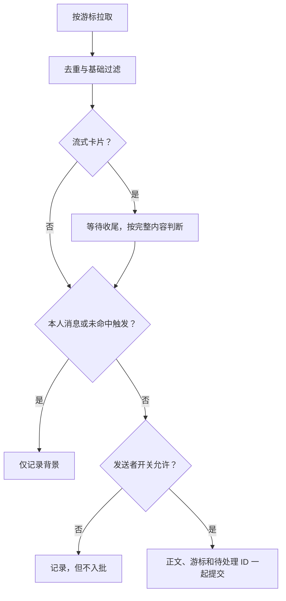

# 飞书分身：监听与派发规则

本文定义自动 Worker 的处理行为。连接与操作见[使用与排障](user-identity.md)，模块和存储见[开发架构](user-identity-architecture.md)，可视化见[消息流程 SVG](feishu-avatar-message-flow.svg)。

## 处理边界

- 通过用户 token 轮询指定会话；不使用个人收件箱实时事件或未读数。
- 新增监听从当前时间开始。只能处理成功拉取的消息，不能保证离线期间历史完整。
- Host 接收批次即清队，这是派发确认，不代表 Worker 已回复。
- 转人工只跳过当前待处理批次，后续消息继续处理。
- 开启机器人处理后，机器人与真人走同一条队列；没有机器人专属冷却时间。
- 不根据“已收到”“正在处理”等文案删除记录，不因同一发送者后续发言替换前一条。

## 默认参数

| 参数 | 当前值 | 作用 |
|---|---|---|
| 轮询间隔 | 30 秒 | 配置范围 5–60 秒 |
| 合批防抖 | 30 秒 | 新待处理消息到达时重新等待 |
| 最长合批等待 | 3 分钟 | 持续来消息时也会派发 |
| 每批上限 | 10 条 | 满额立即派发；余下消息保留 |
| 监听会话上限 | 20 个 | 私聊与群聊合计 |
| 每会话待处理上限 | 500 条 | 满时保留读取进度，等待积压处理 |
| 最近普通消息 / 去重 ID | 50 条 / 500 个 | 待处理正文额外保留 |
| 每会话每轮拉取 | 2 页，每页 50 条 | 未读完保存分页进度 |
| 刷新回看窗口 | 至少 120 秒 | 查询起点为游标减 1 秒和当前时间减 120 秒中的较早值 |
| 全部待收尾卡片上限 | 20 条 | 满时保留读取进度 |
| 流式卡片等待上限 | 创建后 10 分钟 | 超时从待收尾列表移除；独立于发送者处理规则 |

常量以 `src/user-identity/monitor-store.js`、`monitor.js` 和 `src/message-text.js` 为准。升级时，旧配置版本中保存的默认 60 秒轮询会迁移到 30 秒，其他自定义间隔保留。

## 拉取、记录与触发



基础过滤跳过删除、系统、重复和监听起点之前的消息。同一消息 ID 的正文更新会刷新原记录，不生成新任务；旧流式投影不会覆盖已收尾正文。

触发模式按会话配置：

| 模式 | 条件 |
|---|---|
| `all` | 全部新消息；私聊默认 |
| `mention` | @本人或回复本人的消息；群聊默认 |
| `keyword` | 命中关键词、@本人或回复本人，任一满足 |

本人消息始终只作背景。已命中 @ 或关键词时，无需查询父消息；确需判断“回复我”而查询暂时失败时，记录错误并保留游标，下轮重试。

发送者开关在入批和派发前各检查一次。关闭机器人处理时，机器人消息不占批次名额、不重置合批等待、不触发转人工，也不进入 Worker 背景；开启时，纯机器人批次和混合批次均按原顺序处理。

## 流式卡片收尾

发现 `streaming_mode=true` 后，按消息 ID 保存到 `pendingCards`，暂不把正文交给 Worker。后续轮询查询消息详情：

| 状态 | 处理 |
|---|---|
| 已收尾 | 使用最终正文及当前触发规则重新判断，补入消息记录和待处理批次 |
| 仍在输出 | 更新挂起记录中的文本，继续等待 |
| 查询失败 | 保留挂起记录，下轮重试 |
| 创建已超过 10 分钟 | 从挂起记录移除并记录日志 |

因此最终正文才出现的关键词仍可触发；本人卡片仍只作背景。收尾时与普通消息一样解析成员名称和 @标记。补入正文失败时保留挂起记录，避免卡片在入库前丢失。

收尾重放可能晚于其后创建的普通消息，队列按实际入队顺序派发。

## 合批与派发

派发前按当前发送者开关过滤积压，再检查全部待处理消息是否命中转人工关键词。命中时清除当前待处理批次，不创建任务；未命中则取队首最多 10 条。

每个飞书会话复用一个 Worker。工作区 / 预设变化、Worker 已归档或不存在时重建，并重新设置聊天标题。默认预设是 `standard`；未显式指定工作区时使用 DSH 默认工作区。

投递使用 `session.prompt(mode=queue)`，请求 ID 由 chatId 与本批消息 ID 计算。同一会话的手动与定时派发合并为一个进行中的请求；不同会话不共用派发锁。

| 结果 | 队列与后续行为 |
|---|---|
| 创建 Worker 或投递失败 | 保留本批，延迟重试 |
| Host 接收成功 | 只移除本次 ID，保留同时到达的新消息 |
| Worker 决定不回复 | 不发消息，批次仍视为已派发 |
| Worker 后续失败 | 插件不自动补派，不跟踪“已回复”状态 |
| 停止监听 | 取消未开始的定时任务，中止尚未完成的投递请求；保留待处理状态 |
| 重启 / 重新启用 | 恢复未派发积压 |
| 移除监听会话 | 移除其监听记录和未派发批次；保留历史 Worker 的会话绑定 |

取消请求无法撤回 Host 已接收的任务。投递请求超时或被中止时，远端是否已经接收可能不确定；重试仍使用同批请求 ID，不是发送完成确认协议。

## Worker 输入

输入按职责分开，批次内容使用固定快照，动态规则按模型请求更新。

| 来源 | 内容 | 范围 |
|---|---|---|
| 全局 `systemPrompt.section()` | 身份、工具及通用约定 | 普通会话与 Worker |
| `systemPrompt.context()` | 会话名称、chatId、私聊 / 群聊 | 对应 Worker |
| `systemPrompt.context()` | 可自定义的回复规则 | 分身 Worker |
| 用户消息 | 本批正文、发送者、ID、时间、最近背景 | 当前投递任务 |

两块动态正文分别包裹为：

```xml
<feishu_avatar_reply_task_chat>
会话名称："聊天名称"
chatId：oc_example
会话类型：私聊
</feishu_avatar_reply_task_chat>

<feishu_avatar_reply_task_rules>
用户保存的规则，或默认模板
</feishu_avatar_reply_task_rules>
```

标签由程序添加，设置页只编辑规则正文。默认模板定义是否需要回复、使用原会话 chatId、简短自然、同批最多回复一次，以及私聊 / 群聊引用规则；准确原文位于 `src/user-identity/worker-context.js`，全局约定位于 `src/policy.js`。

所有自动 Worker 共用一份 `replyRules`，保存后下一次模型请求读取最新值。自定义文风、标题及引用规则可以覆盖全局相应默认约定；普通会话不注入自动回复规则。

DSH 的 `context()` 实际形成动态 user-role 快照。注册采用 `required: true` 保留必要上下文、`interpolate: false` 保留字面文本。Worker sessionId 与 chatId 的绑定独立于批次持久化，避免清队或重建后丢失会话信息。

## 正文与背景

- 文本正文不作字符截断；图片、文件等仍以类型占位文本表示。
- 每条记录带消息 ID 和秒级时间。背景与本批新消息分别列出。
- 背景来自最近已记录的消息，包括本人回复及未命中触发条件的消息；后续仍排队的消息不会提前作为背景发送。
- 关闭机器人处理时，背景也排除机器人消息。
- 背景以最近一次成功拉取为准，不能保证覆盖尚未拉取的本人答复。更早记录可用 `feishu_avatar_messages` 回查。
- 旧版本已经截断或丢弃的正文不会自动恢复。

以上都是输入、调度和默认提示约定。发送工具仍接受其他明确目标，插件不增加硬绑定、批次回复计数或完成回执。
